# Improving Electrical Schematic Understanding with the ELEC-VQA Dataset: A Comparative Study

中文题意：基于 ELEC-VQA 数据集提升电气原理图理解能力：一项比较研究

## 摘要

电气原理图理解要求模型将端子标注与导线关联起来，区分接线拓扑与触点状态，并在明确的运行假设下论证结论。现有视觉问答基准对原生工程图纸中上述能力组合的覆盖仍然有限。本文提出 ELEC-VQA，一个来源可追溯的电气图纸数据集，原始材料为变电站二次回路的计算机辅助设计图纸。ELEC-VQA 数据集包含 15 个任务类型、10,201 条英文问答和 1,019 个图像配置，其中包括 300 个原始局部窗口与 719 个受控图纸变体。每条记录将简短答案、紧凑证据与有界端子图上的可执行核验关联起来。原生渲染保留导线几何关系，按源项目划分的数据分区减少相关问题与编辑图纸之间的泄漏。两种逐条对齐的监督视图支持对同一 7B 视觉语言模型进行仅答案微调和证据引导微调的受控比较。采用参考引导评价并对未决输出进行暂定补分后，仅答案适配将直接答案满分率从 37.16% 提高到 74.27%。统一解释提示下，E 与 A 的联合正确率为 64.24% 和 46.17%，答案满分率为 67.97% 和 70.16%。补充分数仍待人工审理，逐任务和受控变化分析揭示了证据监督的选择性收益与局限。同时，本文明确区分自动核验参考标注与独立人工审核标注，并将解释的有效性与模型内部推理的忠实性分开讨论。该资源为研究领域数据与简洁证据监督如何影响电气图纸理解提供了可复现的基础。

**关键词：** 思维链监督；电气原理图；工程数据集；基于证据的推理；参数高效微调；视觉问答。

## 1 引言

电气原理图通过端子、导线、触点和设备之间的关系表达工程决策。在图纸审查和检修准备中，工程人员可能需要判断断开某个触点是否会切断支路、哪些故障能够解释已知通断读数，或者一项接线修改是否满足给定要求。上述问题取决于可见拓扑与显式条件的共同作用。仅识别元件名称并不足以回答问题：漏看一小段导线、将没有依据的交叉点当作连接点，或把未知触点状态当作闭合，都可能使结论反转。

引言采用原始DWG回路窗口中的测量规划案例：已知三种候选单触点故障，需要选择最少的通断测量来区分故障结果。上游触点位于相关支路的公共路径上，下游两个触点则分别影响不同支路。因此，在1DK6:4和JD1:1检测导通，可以区分公共上游断开和两种支路故障。模型需要结合端子定位、接线拓扑与明确的故障条件，才能选出两个有效测点。紧凑的故障特征表不仅说明两个测点为什么足够，还说明一次二值测量为什么不够。这个案例体现了本文的标注目标：监督具有可核验依据的工程决策，而不只是识别文字标签。

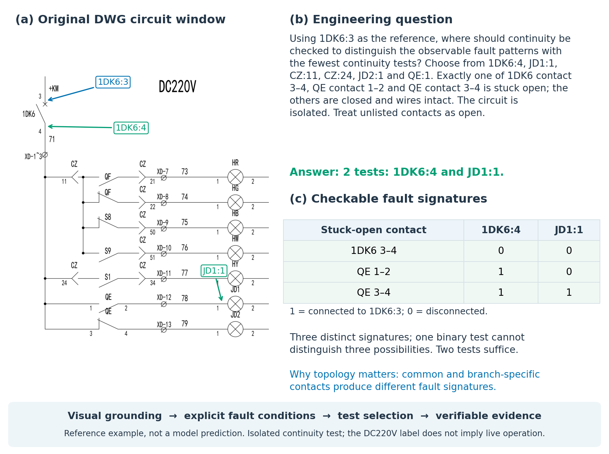

**引言案例（图1）：** 来自训练集的记录 `E4QA_a3ac29e87ddff93314dd`，对应原始DWG局部窗口 `CX_3c3e84824e6a494043`，未实施受控接线修改。问题与短答案使用数据集原文。参考证据以紧凑表格呈现：以1DK6:3为参考，分别测量1DK6:4与JD1:1，三种候选故障对应(0,0)、(1,0)、(1,1)，因此两次检测即可区分，单次二值检测则不足。出图沿用字体与线宽清晰化处理，彩色端子标注仅为编辑叠加，保持原始接线拓扑。相应图查询核验了上述故障特征。下文图号与英文PDF对应。

视觉问答为访问此类信息提供了自然语言接口。面向文档的基准表明，模型需要结合视觉上下文读取文字 [1, 2]；图解和图表基准则进一步考察无法从孤立标注中恢复的关系 [3, 4]。近期工程基准将研究对象扩展到专业制图成果：DrawingVQA 从感知、上下文理解和领域专家推理等层次评测建筑工程图纸 [5]；DesignQA 研究工程要求与技术文档 [6]；MechVQA 面向机械工程图纸理解 [7]。这些研究共同说明，工程图纸问答应当围绕真实工作中的判断需求定义，而不能停留在一般图像描述层面。

电气图解理解本身已有研究基础。CircuitVQA、ElectroVizQA 和 EEE-Bench 分别覆盖电路图像、教学电子学问题以及更广泛的电气电子工程问题 [8, 9, 10]。CircuitSense 研究从视觉电路到符号模型的推导 [11]，OmniSch 则考察原理图实体定位与图结构构建 [12]。本文关注与这些工作互补的问题：如何从原生电气工程图纸构建可复用的训练和评测数据，使局部工程判断具有可检查的证据以及可复现的状态相关标签。

这一目标提出三项要求。首先，自然语言结论必须关联到能够识别的视觉和电气实体。解释即使听起来合理，也需要能够核对其中的路径、阻断条件或诊断备选项。其次，应区分“图上画了什么”和“题目假设了什么”。静态图纸不能证明设备当前的电压或运行状态。最后，评测必须考虑同图多题、相互重叠的窗口以及同源图纸变体之间的依赖关系。将这些观测视为相互独立，可能高估模型对新工程文档的泛化能力。

为此，本文构建 ELEC-VQA。ELEC-VQA 数据集来源于 14 个变电站项目中的 44 份 DWG，包含 10,201 条英文 QA 和 1,019 个图像配置。300 个原始上下文窗口与 719 个受控原生 DWG 变体支持条件连接、诊断歧义、测点选择和限定范围的设计检查等任务。每个答案附带简短证据序列；端子标识、源几何和可执行图查询保留了核验依据。图结构用于构建和核验标注，不作为图像问答模型的额外输入。

数据集还支持对监督策略进行受控比较。我们使用相同的 7B 视觉语言骨干，分别以短答案和“紧凑证据＋同一答案”进行微调，并采用标准 LoRA 完成领域适配 [13]。本文所说的证据引导思维链，是可在外部检查的中间陈述，而非对隐藏内部计算的访问，也不代表已经建立了独立的大模型教师蒸馏流程。实验目标是确定这类监督在哪些任务上有效、无效或有负面作用，而不是预设其在所有任务上都更好。

本文的主要贡献包括：

1. 构建一个包含 15 类任务的 CAD 电气图纸数据集，提供简洁的英文问答、紧凑证据和端子级来源信息。
2. 提出结合原生出图、受控接线修改、可执行核验和源数据隔离划分的数据构建与核验流程。
3. 设计区分通用模型基准测试、答案与证据监督对照、答案语义正确性和证据有效性的比较研究方案。

本文的实证范围是变电站二次接线图中的电气原理图理解；对更广泛电气领域的迁移仍需实验验证。第 2 节讨论相关研究，第 3 节介绍数据构建，第 4、5 节分别给出方法和实验方案。

## 2 相关工作

### 2.1 文档与图解视觉问答

TextVQA 要求识别图像中文字并结合上下文使用这些文字 [1]。DocVQA 将问答扩展到文档页面，其中布局和结构决定文本证据如何解释 [2]。ChartQA 与 InfographicVQA 进一步要求联合理解文字、图形和定量关系 [4, 14]。这些资源表明，应联合评测识读与推理，但其文档语义不同于电气图纸的导线和触点关系。

AI2D 使用图解元素及其关系描述图解理解任务 [3]；GQA 依托结构化场景表示生成组合问题，并考察一致性 [15]。它们为显式表示和关系核验提供了思路，不过一般场景图本身并不表达触点状态变化下的电气导通。MMMU 涵盖包括工程在内的多学科多模态知识 [16]；而定位到具体端子和连接关系的失误，仍需要更专门的数据与评测。

### 2.2 工程图纸与专业问题设计

DrawingVQA 与本文具有较强的相关性：它同样使用真实工程图纸，并强调具有职业意义的问题 [5]。其建筑图纸基准包含 33 张图和 92 条精心整理的 QA，并从推理深度、工程维度和模型能力维度组织问题。它启发我们区分识别、上下文解释和工程判断。本文的差异在于对象与核验机制：通过有界 CAD 端子图表达电气导通和显式状态干预。本文不跨不同数据集直接比较准确率，也不将自动生成标注等同于专家撰写标注。

DesignQA 将工程文档、视觉材料和要求核对关联起来 [6]。这种“应用要求”的视角与本文的限定设计检查有关，但本文把要求直接写入题目，而不是让模型推测未提供的规范。IEEE Access 中关于多模态文档分割的研究，进一步将技术问答与局部视觉元素组织联系起来 [17]；本文则提供固定局部图像，不评测文档检索。MechVQA 将机械图纸与识别、推理、判断任务以及领域适配结合起来 [7]。这些研究支持以数据集为中心的比较研究：贡献在于如何表达领域决策、如何记录标注来源以及如何诊断模型能力，而不只是图文问答数量。

### 2.3 电气原理图与电路推理

较早的基于图的电路草图识别研究，处理手绘电路元素的结构化解释 [18]。CircuitVQA 考察电路图中的元件、数值、节点和位置 [8]。ElectroVizQA 面向数字电子学问题 [9]；EEE-Bench 覆盖多个电气电子工程子领域 [10]。CircuitSense 强调从视觉输入推导符号电路模型 [11]；OmniSch 关注原理图实体定位与带空间权重的网表图恢复 [12]。近视校正相关研究则关注电路理解中的局部视觉检查 [19]。这些方向说明，仅有回答级得分不足以确定失误来自文字读取、拓扑恢复还是后续推理。

ELEC-VQA 提供原生工业接线截图、明确的触点假设和简短的可核验证据，与上述工作形成互补。其任务限定为可见外部连接，不涵盖无限制的模拟电路仿真、设备完整行为或无文档依据的内部接线。

**表 I 已完成：** 在英文PDF中按文献给出的来源、问题重点、证据/核验和评测单位作描述性对比，不构成共同测试条件下的性能排名。

### 2.4 证据监督与评测

ScienceQA 研究带解释监督的多模态问答 [20]；A-OKVQA 提供需要知识推理并附理由的视觉问题 [21]。Multimodal-CoT 将理由生成与答案推断分开 [22]；Distilling Step-by-Step 使用教师生成的理由监督较小语言模型 [23]。这些工作支持研究中间监督，但并不意味着更多解释 token 能改善所有电气任务。本文证据来自 CAD 图和规则，而不是一个已记录的大模型教师。

解释评测需要独立定义“支持”。多模态解释研究区分文字论证与视觉证据 [24]，ERASER 区分理由的一致性与忠实性 [25]。DRAGON 在提供正确答案的条件下评测图解证据定位 [26]；本文的主任务则要求模型从截图和问题预测答案。生成的理由也可能遗漏真正影响预测的因素 [27]。因此，我们将显式证据视为可检查的解答凭据，而不将语言流畅等同于内部推理可靠。

视觉指令微调和开放视觉语言模型提供了实现基础 [28, 29, 30]，本文不提出新的多模态架构。模型裁判同样需要验证：已有研究记录了位置偏好、冗长偏好和自偏好等问题 [31]，因此评分应结合匿名输出、结构化参考事实和独立核验，而非使用不受约束的偏好分数。

对于生成式VQA，LAVE以参考引导的语义评价替代严格字符串匹配 [32]。已有研究也将Qwen2.5-32B-Instruct用作裁判基线 [33]。本文据此制定端子身份、触点条件、解的完整性和有效替代方案等电气评分标准。该先例支持方法选择，不代表模型已在电气图纸上可靠，仍需独立人工校准。

BERTScore通过上下文token表示比较生成文本与参考文本，而非要求逐词相同 [34]。电气QA还需明确核查端子身份与状态相关结论。G-Eval提供结构化量表评价框架 [35]，LLMBar则说明有说服力的文风可能误导指令遵循评价 [36]。因此，本文采用领域评分标准并验证裁判判断，而非将通用文本相似度当作完整的电气正确性指标。

## 3 ELEC-VQA 数据集构建

### 3.1 来源、范围与样本单位

ELEC-VQA数据集包含来自14个变电站项目、44份DWG的10,201条QA。1,019个图像配置由300个原始局部窗口和719个受控DWG变体组成。原始窗口包含周围图纸上下文，同一图纸中的窗口可以重叠。每条记录保留项目、DWG、父窗口和图像配置标识，以支持划分与分析时对相关样本进行分组。

模型输入单位是能够识读的局部原理图，而不是整张图幅。选取窗口时，优先考虑能够以有界表示描述的可见外部接线和显式触点。问题不局限于文字转录，但符号和标注识别仍是更高层任务的前提。

**图 2：数据构建流程**

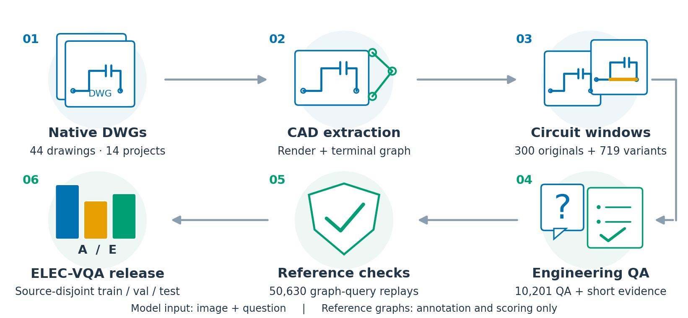

**表 II：源数据隔离划分**

| 划分 | 项目 | DWG | 原始窗口 | 变体 | 图像 | QA |
|---|---:|---:|---:|---:|---:|---:|
| 训练 | 11 | 29 | 218 | 479 | 697 | 6,972 |
| 验证 | 1 | 8 | 34 | 88 | 122 | 1,155 |
| 测试 | 2 | 7 | 48 | 152 | 200 | 2,074 |
| 合计 | 14 | 44 | 300 | 719 | 1,019 | 10,201 |

### 3.2 原生出图与来源追溯

图元提取和出图使用 AutoCAD ActiveX COM 接口。修改源 DWG 线宽前先备份，备份与修改后文件分别保存哈希。几何实体线宽设为 0.35 mm，不改变实体坐标。出图使用字体已修复的配套工作副本和项目专用打印设置，原生导出矢量 PDF，再根据 CAD—图像映射栅格化和裁剪。该流程不同于对像素进行膨胀或使用生成模型重绘。线宽调整仅用于出图，导线坐标与连接点拓扑保持不变。

端子位置、导线几何、源标识、裁剪范围和图像哈希支持追溯。故障修改在原生工作副本中执行，并采用配准视图出图。展示用局部放大图与实际输入模型的完整发布截图分别记录。

**图 3：原图与受控跨网络连接、参考图**

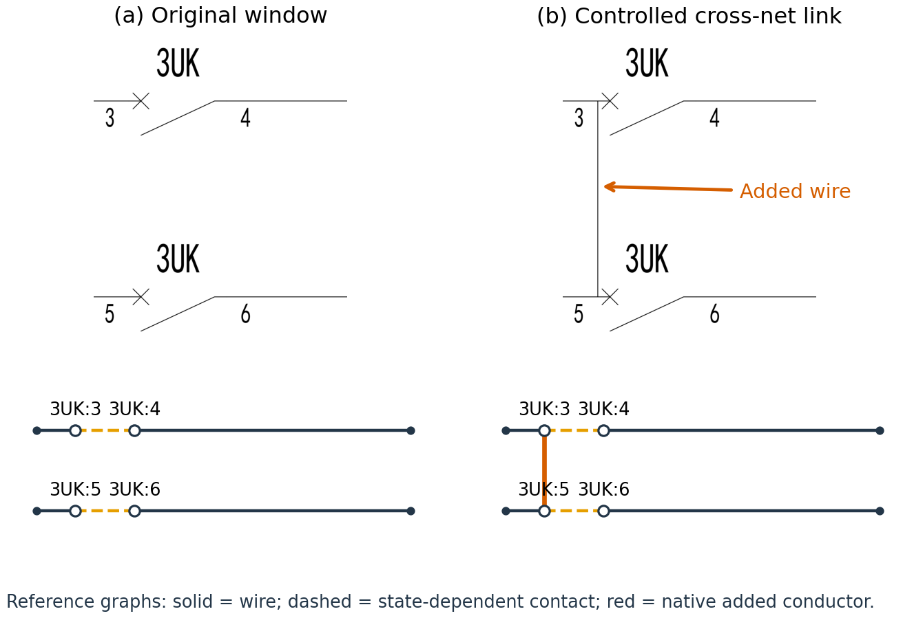

### 3.3 随状态变化的电气表示

局部回路表示为 (G=(V,E_w,E_c))：(V) 为端子和连接点，(E_w) 为外部导线，(E_c) 为显式建模触点。给定状态赋值 (s)、删除导线集合 (R) 和可选跨接线集合 (J)，活动图为：

\[
G_{s,R,J}=\left(V,(E_w\setminus R)\cup\{e\in E_c:s(e)=1\}\cup J\right).
\]

活动图中的可达性决定限定范围内的导通。触点在图上的画法不能替代题干指定的状态。相关状态未知时，分别核验允许的状态赋值，答案可以是“取决于该状态”。几何交叉不自动视为电气连接，也不推测未提供的设备内部路径。

该表示不能确定实际电压、电流大小、保护动作或系统安全。诊断采用题目指定的故障集合；除非另有说明，通断测试假设回路隔离且导线完好。这些条件使答案可核验，也限定了工程结论的边界。

### 3.4 问题、答案与紧凑证据

15 类任务依次为：条件连接 T01、最小闭合组合 T02、导线分组 T03、断开触点影响 T04、未知状态 T05、旁路分析 T06、故障候选 T07、测点选择 T08、显式设计要求 T09、修复检查 T10、路径顺序 T11、触点网络关系 T12、诊断充分性 T13、电压信息充分性 T14 和支路中断 T15。这是任务分类，而不是 15 个经过独立验证的难度等级。

**表 III：各任务QA数量**

| 任务 | 类型 | 训练 | 验证 | 测试 | 合计 |
|---|---|---:|---:|---:|---:|
| T01 | 条件连接 | 1,495 | 259 | 440 | 2,194 |
| T02 | 最小闭合组合 | 666 | 103 | 181 | 950 |
| T03 | 导线分组 | 697 | 122 | 200 | 1,019 |
| T04 | 断开影响 | 665 | 103 | 181 | 949 |
| T05 | 未知状态 | 665 | 103 | 181 | 949 |
| T06 | 旁路分析 | 665 | 103 | 181 | 949 |
| T07 | 故障候选 | 471 | 58 | 127 | 656 |
| T08 | 测点规划 | 467 | 58 | 127 | 652 |
| T09 | 显式要求 | 697 | 122 | 200 | 1,019 |
| T10 | 修复检查 | 130 | 24 | 69 | 223 |
| T11 | 路径顺序 | 164 | 30 | 57 | 251 |
| T12 | 触点关系 | 60 | 20 | 40 | 120 |
| T13 | 诊断充分性 | 60 | 20 | 40 | 120 |
| T14 | 电压充分性 | 10 | 10 | 10 | 30 |
| T15 | 支路中断 | 60 | 20 | 40 | 120 |

问题采用结合回路的模板和受控问法变体。问答使用英文，必要时引用图中原始中文。单图支持不同判断，而不是把同一问题的重复改写算作新增语义案例。主记录将简短答案、结构化结果、紧凑证据、源实体和核验查询分开保存。证据仅保留与结论有关的条件、导通路径或阻断事实，以及必要的备选解释。正向可达性由具体路径支持；否定结论则在结构化记录中保留求解器的可达区域，而不是把“没有列出路径”当作不连通证明。

证据正文上限为本地 Qwen tokenizer 下的 192 tokens，不含标题和答案；发布数据的最大值为 189，平均值为 39.63。超预算候选直接排除，不截断证据。T12 当前只包含串联和独立网络关系，没有核验通过的并联案例。T14 全为否定充分性答案，因此只作为诊断控制，不用于证明视觉推理能力。

**图 4：任务构成、证据长度与图像来源**

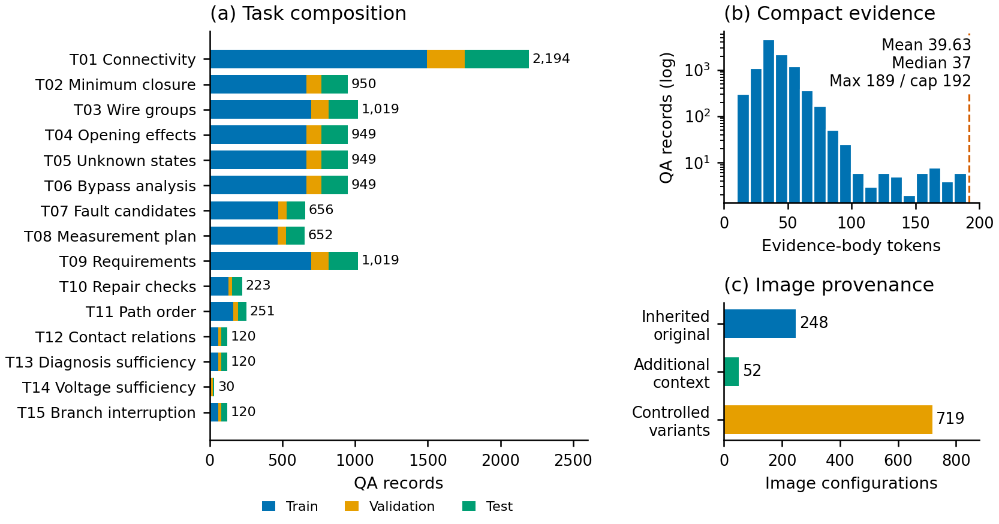

### 3.5 干预、核验与数据划分

719 个变体包括缺线、触点旁路、误接和跨网络连接。它们是人工控制的图纸修改，不代表真实现场故障频率。任务在明确的触点状态与故障假设下实例化；候选问题仅在其参考结果与证据通过相应核验查询后保留。

发布审计重放了 50,630 次图查询，并检查训练视图对齐、语义规格重复、文件哈希和划分成员身份。重复检查比较同一图像和任务中的参数与核验条件，不代表证明全部问题在概念上独立或图结构非同构。出图审计另行检查图像解码和几何一致性。这些检查证明与已提取表示的一致性，不等于独立专家正确性：共同的提取错误可能通过图查询重放。

训练、验证和测试分别包含 6,972、1,155、2,074 条 QA，对应 697、122、200 个图像。源项目、DWG 和父回路族跨划分隔离；相互重叠窗口和变体保持分组，但不同项目仍可能出现电气上相似的模板。数据构成、来源和使用条件应明确记录，这与数据集说明文档的研究原则一致 [37]。实验部分分别说明构建一致性核验与独立参考质量评估。

## 4 证据引导适配与评测

### 4.1 对齐监督视图

对截图 (I_i)、问题 (q_i)、短答案 (a_i) 和紧凑证据 (e_i)，两种主要目标为：

\[
y_i^A=a_i,\qquad y_i^E=\texttt{Evidence: }e_i\;\texttt{Answer: }a_i.
\]

两种视图具有相同 ID、问题、截图和最终答案。参考图、编辑标签、结构化结果和预期证据不附加到模型输入。因此，两适配器的差异来自所测试的监督方案，而不是获得了额外的推理时标注。

**图 5：A/E 对齐监督方式**

图5采用ELEC-VQA数据集中的诊断充分性样本，使用数据集中的原始英文问题、证据与答案。3UK:6至3UK:4的导通检测失败时，串联路径上的5–6触点或3–4触点故障均可解释该现象，因此不能唯一定位3–4触点。仅答案监督给出“No.”；证据监督还明确两个候选故障及其相同的可观测结果。设计目的是使监督信号包含元件定位、备选故障和诊断信息不足的边界，实际收益仍须通过答案正确率和证据有效性实验检验。图中为参考标注，并非模型预测；截图仅作展示裁切，不改变训练图像。

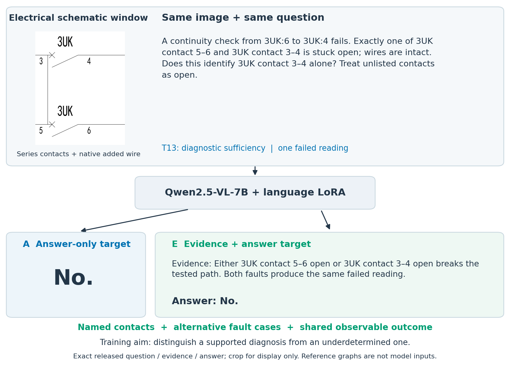

骨干采用 Qwen2.5-VL-7B-Instruct [29]。标准 LoRA 更新语言注意力的 query、key、value、output 投影；基础权重与视觉模块保持冻结 [13]。训练目标为：

\[
\mathcal L=-\sum_i\sum_{t\in\mathcal A_i}\log p_\theta(y_{i,t}\mid I_i,q_i,y_{i,<t}),
\]

其中 (mathcal A_i) 不含用户、图像与 padding 位置。训练对所有assistant目标token等权处理。证据目标更长，因此相同 epoch 不等于相同监督 token 或计算量。

配置使用 BF16、rank 16、缩放系数 32、dropout 0.05、学习率 (10^{-4})、3 epochs、微批次 1 和梯度累积 8。图像面积上限为 2,097,152 像素，上下文为 8,192 tokens，固定慢版 Qwen processor 和 SDPA。运行环境为 Ubuntu 22.04 与单张空闲显存充足的 H100。主比较使用种子42与最终epoch的适配器。

**表 IV：匹配训练配置。** 两种监督采用同一骨干、6,972条训练QA、697幅图像，以及相同的LoRA与优化设置。模型标识、更新次数和监督token数量见训练记录。

### 4.2 参考引导语义评价

自然语言完全匹配不适合直接比较通用模型的长回答与适配器的短答案。正确结论可以不以固定前缀开头，措辞相近的回答也可能反转端子关系或触点状态。因此，本文采用借鉴LAVE的共同参考引导裁判，对所有模型使用相同的直接评分流程 [32]。每次请求包含原题、完整未改写回答、参考短答案、固定任务量表和确定性参考事实包。事实包包括结构化结果、相关任务参数、带标识节点与边、核验查询。这些仅供评价端使用，不输入被测视觉问答模型；裁判也不承担重新识别截图的任务。

评分关注最终答案是否满足电气任务，而非是否模仿参考措辞。量表明确端子、否定、显式条件、集合完整性和路径顺序，并接受其他有效最小测点方案或导通路径。无法从参考规范核实的替代解应进入图核验或复核。Base、A、E和其他基线使用同一请求构造。此前的盲提取再规则核验保留为诊断选项，不再作为主要判分路径。

令裁判等级为 \(r_i\in\{1,2,3,\bot\}\)：3表示完整正确；2只用于量表允许的明确正确但不完整答案；1表示错误或未回答；\(\bot\)表示评价待判。已判定项的辅助语义分为：

\[
s_i=(r_i-1)/2,\qquad c_i=\mathbb{1}[r_i=3].
\]

主要准确率仅计满分。二元决策、三值状态分类和单一关系类别不给部分分。裁判自己的不确定不是0.5。若总题数为N、已判定集合为R，则：

\[
A^-={\sum_{i\in R}c_i\over N},\qquad A^+=A^-+{N-|R|\over N}.
\]

这只是待判结果的上下界，不是统计置信区间。覆盖率为已判题数/N，平均语义分也保留全样本分母并报告相应界限。空回答和明确错误仍属模型失败，不能作为待判项排除。

答案与证据分别评价。解释更长不加答案分，也不因长而扣答案分。最终答案正确但解释细节错误时，答案可得分，证据或联合正确则失败；最终结论自相矛盾时不能只挑正确的一句。主要报告14任务QA微平均、任务等权宏平均和源DWG宏平均；T14的10道全负测试题另列，主测试为2064题。裁判校准与参考质量评估用于衡量自动评分的可靠性 [31, 36]。

### 4.3 受控变化与证据指标

视觉配对在不同截图上使用相同问题，条件配对则固定截图并改变相关触点状态。配对审计核查问题身份与参考结果，同时保留应翻转与应不变的情形。

配对两题都正确的比例为：

\[
A_{\rm pair}=\frac{1}{|\mathcal P|}\sum_{(i,j)\in\mathcal P}S_i(\hat a_i)S_j(\hat a_j).
\]

仅改变答案不代表正确的变化敏感推理，两题均须满足各自条件。配对统计保留共享来源，区分结果翻转与不变情形。测试集来自两个项目的7份DWG，因此对更广工业总体的推断受限。

证据核查关注实体定位、路径或阻断事实、题干条件、必要备选解释和对最终答案的支持。联合正确要求答案与证据同时正确。应接受其他有效证据，而不是与参考长句逐字比较。这些标准评测可见解释，不证明隐藏计算忠实性 [25, 27]。

### 4.4 公平输入与推理预算

受控比较包含未微调骨干 Base、仅答案适配器 A 和证据＋答案适配器 E。InternVL2_5-8B 和 LLaVA-OneVision Qwen2 7B 提供跨系列零样本参照 [38, 39, 30]。模型接收同一图像和问题，但使用各自原生 processor；记录像素预算、切块、视觉 token、版本和提示，不将其称作逐像素相同的预处理。

采用两条共用提示轨道。主轨对所有比较模型追加“Give a brief answer in English. Do not include an explanation.”。解释轨对Base/A/E要求说明相关可见元件、连接和条件，并以Answer行给出短答案。每轨均保留完整回答，格式不是评分标准。贪心解码和768新token上限先在验证集检查再冻结，任何截断调整均记录。向纯文本模型提供网表是额外辅助输入；文本裁判只在评价侧使用。

## 5 实验与比较研究

### 5.1 实验设置与评分来源

训练、验证与测试分别包含 6,972、1,155 和 2,074 条 QA。主要测试排除十条 T14 诊断控制，采用来自七张图纸、两个项目的 2,064 题。比较 Base、仅答案适配 A、证据加答案适配 E，以及 InternVL2.5-8B 和 LLaVA-OneVision。两个适配模型均使用种子 42。所有模型接收相同图像与问题并使用原生预处理；贪心解码上限为 768 个新 token。直接模式要求简短答案；统一解释模式对 Base/A/E 要求给出相关元件、连接和条件后作答。

Qwen2.5-32B-Instruct 是唯一自动裁判。参考引导的评分分别衡量答案与证据；3、2、1 分对应完全正确、量表允许的不完整正确和错误，语义分为 1、0.5、0。正确简短答案无需解释，二元问题不设部分分。

当前主表补入了 585 条原先未决评分：直接答案 28 条、解释模式答案 75 条和证据 482 条，涉及 552 个响应与 517 道题。原始非空 Qwen 评分保持不变。补分依据参考与响应进行助手暂定归类，其中 85 条恢复原裁判尝试中一致的数字建议；尚无独立人工确认。因此，当前结果属于混合评价来源的暂定结果，不能描述为全部来自自动裁判或已经专家审核。原始 Qwen 结果作为敏感性分析保留，未通过删题提高分数。

采用 QA 微平均、任务宏平均、图纸宏平均及语义分。按七张来源图纸进行 2,000 次聚类 bootstrap；区间不包括裁判偏差、暂定补分有效性或训练种子波动。

### 5.2 跨模型答案比较

| 模型 | 直接答案满分率 | 任务宏平均 | 图纸宏平均 | 语义分 | 补分条数 |
|---|---:|---:|---:|---:|---:|
| A | 74.27% | 74.98% | 59.89% | 75.34% | 3 |
| E | 52.42% | 52.39% | 40.73% | 52.98% | 3 |
| base | 37.16% | 33.93% | 42.10% | 38.06% | 11 |
| internvl | 34.45% | 32.83% | 35.66% | 35.47% | 4 |
| llava | 34.54% | 32.28% | 30.47% | 35.00% | 7 |

A 的直接答案满分率为 74.27%，基础模型为 37.16%；E 为 52.42%。领域适配有效，但 E 并不全面优于 A。跨系列结果还受到预训练和原生处理器差异影响。

### 5.3 提示方式、答案与证据

| 模型 | 解释模式答案 | 解释模式证据 | 同一响应联合正确率 |
|---|---:|---:|---:|
| base | 39.00% | 32.17% | 31.93% |
| A | 70.16% | 46.27% | 46.17% |
| E | 67.97% | 64.78% | 64.24% |

E 的解释模式答案相对直接模式增加 15.55 个百分点，A 变化为 -4.12 个百分点。解释模式 A−E 答案差异为 2.18 个百分点，图纸聚类区间为 [-1.61, 6.65]，跨越零，不等于证明等效或 E 稳定领先。

E−A 联合正确率差异为 18.07 个百分点，区间 [16.04, 20.44]。完全不采用补分时，原始 Qwen 联合下界为 A 46.08%、E 63.76%，未决上界为 63.18%、64.78%；原始直接答案下界为 74.18%、52.37%。因此核心排序不依赖暂定补分，但仍可能受到参考和裁判系统误差影响。

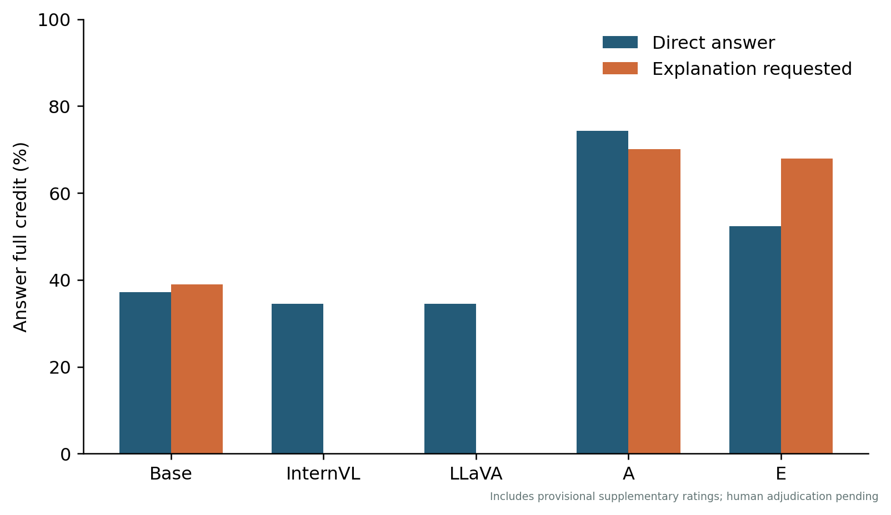

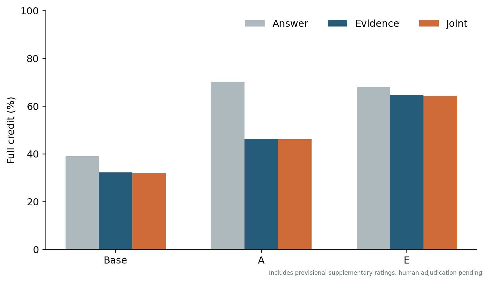

### 5.4 E 在哪些任务上更好

| 任务 | 样本数 | E−A 答案差异（百分点） | E−A 联合差异（百分点） |
|---|---:|---:|---:|
| T01 | 440 | -5.68 | +38.64 |
| T02 | 181 | -9.39 | -13.81 |
| T03 | 200 | -12.50 | -13.50 |
| T04 | 181 | +6.63 | +30.94 |
| T05 | 181 | -5.52 | -4.97 |
| T06 | 181 | -14.36 | -4.97 |
| T07 | 127 | -3.94 | -6.30 |
| T08 | 127 | +42.52 | +44.88 |
| T09 | 200 | -2.00 | +46.50 |
| T10 | 69 | -11.59 | +21.74 |
| T11 | 57 | +5.26 | +7.02 |
| T12 | 40 | -7.50 | +10.00 |
| T13 | 40 | +15.00 | +80.00 |
| T15 | 40 | +7.50 | +50.00 |

收益集中于测量规划、诊断充分性、部分触点断开影响与路径顺序任务；最小闭合、线网分组和假设旁路仍有退步。逐任务比较属于探索性描述，未进行多重比较校正。

原始 DWG 案例中，在 3UK 3–4 闭合时，问题询问跨接开放的 2ZJ 24–23 是否能让 3UK:4 连到 CZ:41。A 在两种提示下均错，E 在解释提示下正确给出 3UK:4 → 3UK:3 → 2ZJ:24 → 2ZJ:23 → CZ:41。该例展示外显分解成功，不证明内部思维的因果机制。

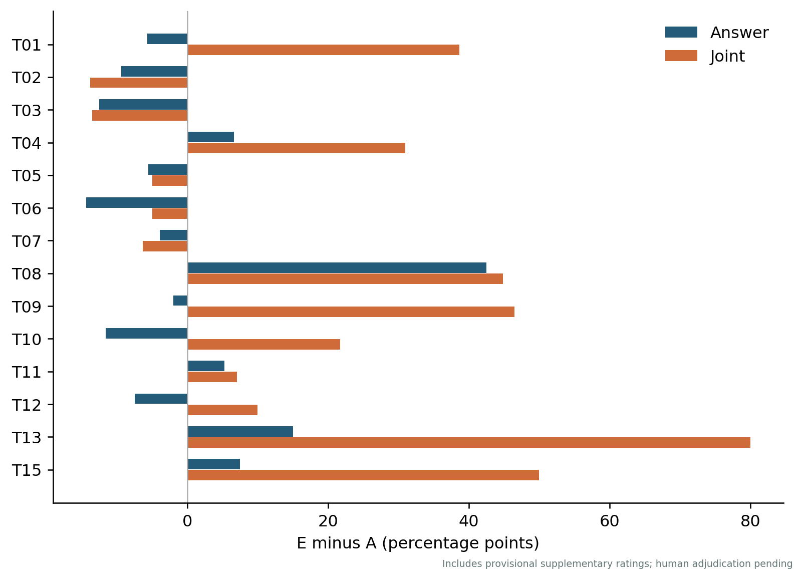

### 5.5 正确答案中的证据支持

参考 e-ViL 对答案和解释质量的区分 [40]，条件支持率为“答案和证据均满分的数量 / 答案满分的数量”。A 为 65.81%，E 为 94.51%，Base 为 81.86%。A、E 的正确答案中分别有 34.19% 和 5.49% 没有满分证据；这些可能是缺失、不完整或错误证据，不能统称为虚构。不同模型的正确答案子集不同，不能把条件比例当作在相同子集上的因果比较。ERASER 的充分性和完备性需要输入干预及重新预测，不能从静态输出推算 [25]。

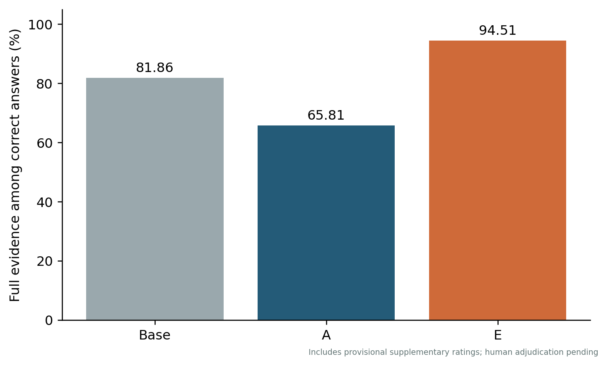

### 5.6 受控变化与复杂度

借鉴 GQA 一致性评价 [15]，配对成功要求两个答案均正确，而不只是输出变化。解释模式下，状态翻转对 A 为 55/82（67.07%），E 为 77/82（93.90%）；状态不变对 A 为 60/97（61.86%），E 仅为 11/97（11.34%）。视觉不变对 A 为 36/46（78.26%），E 为 40/46（86.96%）；视觉翻转对 A 为 9/23（39.13%），E 为 1/23（4.35%）。这些互补结果说明 E 对部分相关状态变化响应较好，但无关状态选择与视觉拓扑辨识仍弱。配对共享图纸和题目，不是独立重复试验。

至少三个条件的 98 题中，E 答案满分率为 63.27%，A 为 43.88%；两个条件时分别为 73.08% 和 73.63%；一个条件时 E 较差。参考路径 4–6 条边时 E/A 为 61.81%/58.32%，7 条及以上时为 53.00%/49.77%。未记录路径的题目单列。任务组成和复杂度混杂，不能推出证据收益随复杂度单调增长。

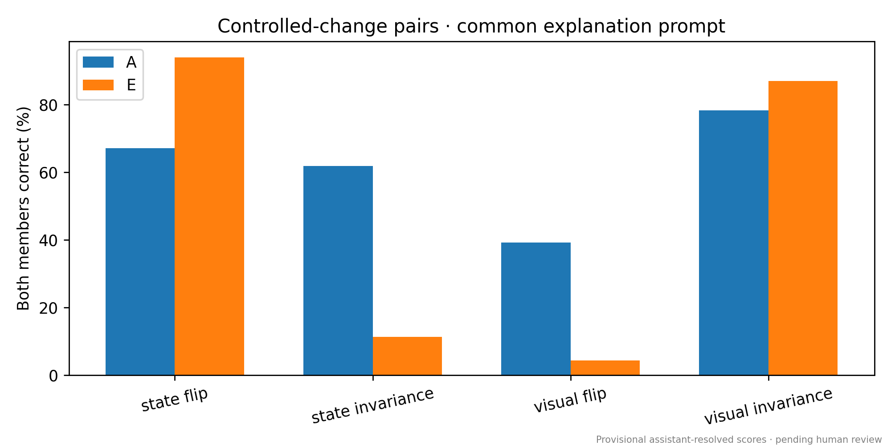

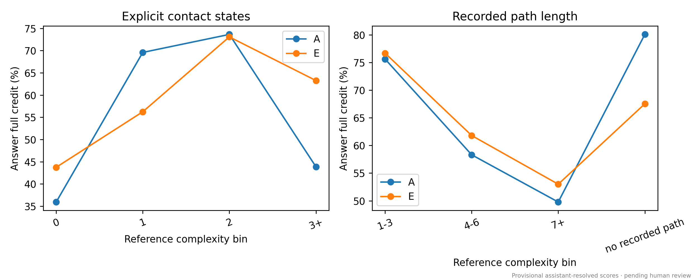

### 5.7 生成开销与局限

Base/A/E 直接模式平均生成耗时为 0.65/0.73/1.21 秒；解释模式为 6.67/0.82/2.30 秒，平均输出长度为 278.13/13.10/54.81 token。E 的证据收益伴随额外生成成本。效率统计保留全部 2,074 个测试响应，包括 T14；准确率统计排除 T14。单响应耗时不是部署吞吐量，也不是硬件归一化的架构比较。

本研究只有一个训练种子、七张测试图纸，参考标注尚无独立专家核验，补分仍待人工审理。这些限制不允许宣称普遍工业泛化、证据监督全面优越或内部推理忠实性。

## 6 代表性案例与讨论

### 6.1 可核验推理的参考案例

附录展示来自六个不同原始DWG窗口的训练样本，覆盖最小闭合、导线分组、未知状态、故障诊断、路径顺序及支路中断，说明标注语义而非留出模型表现。

这些样本区分三类电气难点。首先，导线分组不同于经闭合触点的连通，必须识别哪些边依赖题干条件。其次，故障诊断需要比较不同假设的观测结果，而非仅寻找外观断开的触点。最后，状态变化可能与待查支路无关，因此中断判断应追踪实际路径。紧凑证据通过路径、反例或短观测特征使这些区别明确可查。

### 6.2 如何解释证据监督的效果

证据能将任务分解为相关实体、状态赋值和核验步骤，但也可能引入无依据的中间陈述或冗余 token。只有最终答案比较、提示轨道和评分方式一致时，E 的更高得分才支持所测试的紧凑证据方案。如果 E 改善诊断却损害简单连接，任务权衡本身就是结果。答案正确条件下的证据有效率与联合正确率，能够区分有效解答凭据和“听起来有说服力但不正确”的解释。

负面结果也应分解。虚构路径可能源于端子误读、错误连接点、忽略状态，或前文生成错误的传播。固定证据池与变化敏感配对用于区分这些可观测失误，但不能揭示隐藏内部因果推理。长解释既不是正确性的必要条件，也不是充分条件。

### 6.3 范围、依赖和标注局限

ELEC-VQA 是任务领域名称，当前实证材料仍是变电站二次接线图，而非全部电气图纸。两个留出项目、300 个部分重叠原始窗口限制了广泛工业迁移结论。不同图像哈希和源隔离不能排除工程模板复用或抽象图同构。广泛跨领域结论需要更多样的外部来源。

自动标注可能因错误实体提取而产生自洽但视觉上不正确的答案。追溯记录便于修订，却不能替代独立审核。T12 无并联样本，T14 有固定否定先验，模板问法也可能形成捷径。因此，需要逐任务结果、标签先验控制和诊断任务隔离。原生改线是受控扰动，不代表真实故障发生率或经过验证的检修操作流程。

### 6.4 对电气图纸理解的启示

实验区分简洁决策支持和具有明确证据的解释。证据监督提高了可核验说明的质量，并改善部分多条件任务；仅答案监督仍保持更高的直接回答精度。状态不变与视觉翻转测试暴露了条件选择和拓扑辨识方面的不足，后续应同时监督相关变化与无关变化，并扩大图纸来源和重复训练种子。

## 7 结论

ELEC-VQA 将 10,201 条工程问答、1,019 种图像配置、紧凑证据与来源隔离评测结合起来。比较实验显示领域适配带来显著收益，但答案正确性和证据支持质量必须区分。仅答案适配的直接回答满分率为 74.27%，高于基础模型的 37.16%。在统一解释提示下，证据适配模型的答案与证据联合正确率为 64.24%，高于仅答案模型的 46.17%；二者答案满分率分别为 67.97% 和 70.16%。

证据的收益集中于更可靠的显式支持、测量规划及部分多条件任务。受控变化测试同时暴露出无关状态不变性与视觉拓扑辨识方面的不足。因此，研究支持同时建模相关和无关电气变化的证据监督，而不支持更长解释普遍改善理解的假设。更广泛的图纸覆盖、独立参考标注核验与多随机种子训练，仍是检验泛化性的必要工作。

## 数据可用性

ELEC-VQA数据集提供源分组划分、截图、对齐训练文件、紧凑证据和机器可读核验记录。随文材料包括图像、标注、训练视图及评价代码。

## 附录：补充数据样本与复现记录

### 原始图纸窗口中的多样化样本

图8–10展示六个训练样本，分别来自六个不同的原始DWG窗口，未实施受控接线修改，且不重复正文截图。问题与短答案保持发布原文，简洁证据摘要突出相应图查询。它们说明数据内容，不是模型预测或现场故障记录。完整ID、原图路径、源DWG及图像哈希记录在案例清单中。

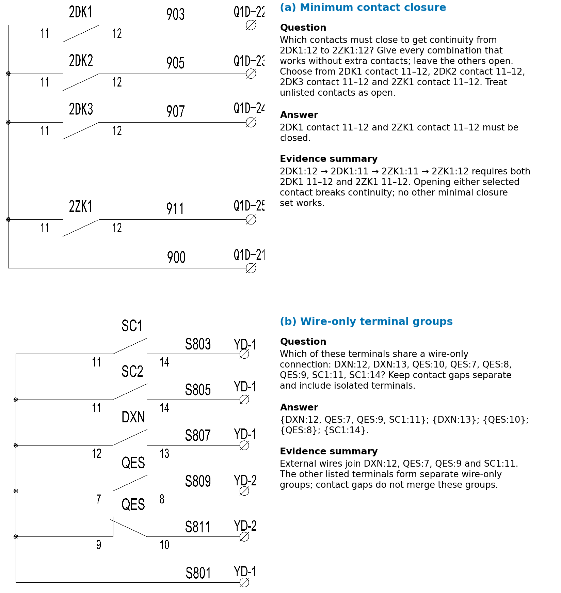

**图8：** 最小闭合组合与导线端子分组。触点导通遵循题干条件，而导线分组排除触点边。

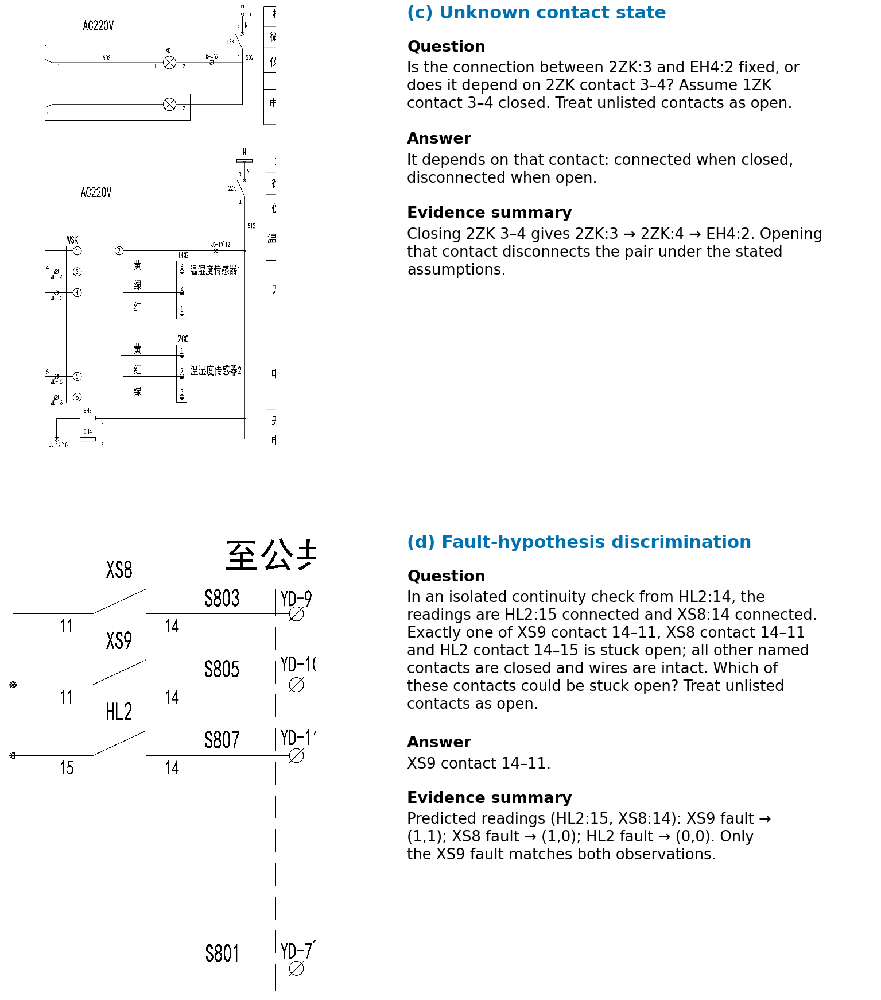

**图9：** 未知状态与故障假设区分。不同状态及故障假设对应不同的导通结果。

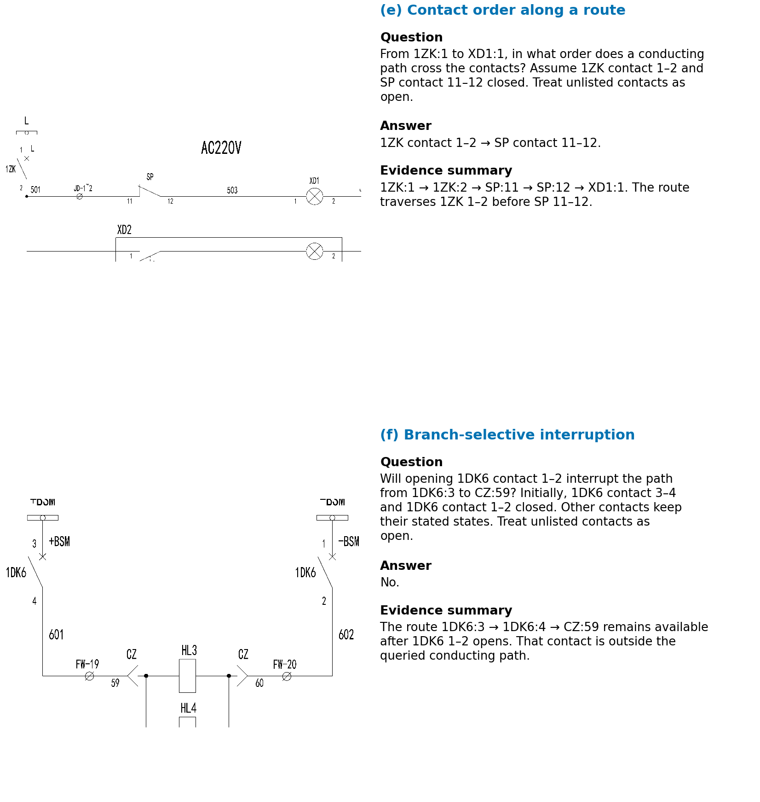

**图10：** 路径上的触点顺序与选择性支路中断。有效路径明确经过哪些触点，无关触点断开不改变待查支路连通。

### 标注与评价记录

每条标注包含问题、短答案、紧凑证据、结构化结果、任务参数和来源。核验查询保留触点状态、图修改、连接结果，以及路径或可达区域。两种训练视图序列化相同图像—问题样本，不增加独立QA数量。

预测记录保留完整回答、模型所见问题、图像哈希、解码和预处理元数据。评分记录保留回答哈希、参考身份、量表哈希、裁判版本、原始评分和待判原因。Qwen2.5-32B-Instruct作为唯一自动裁判，使用电气三档量表，答案与证据分开评分，支持在不改写模型回答的情况下复核。

### 结构覆盖与配对清单

图11总结300个原始窗口的有界参考图，不含编辑变体；这些统计不是截图全部元件的计数。相互重叠窗口不等于独立电路设计。

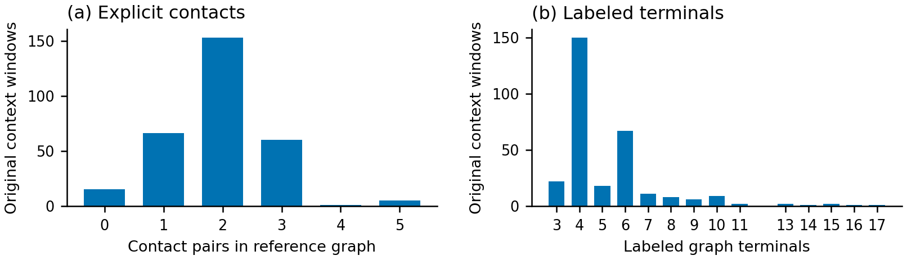

**表 XIII：重新核验的二元配对数量**

| 划分 | 视觉翻转 | 视觉不变 | 条件翻转 | 条件不变 |
|---|---:|---:|---:|---:|
| 训练 | 79 | 178 | 340 | 283 |
| 验证 | 13 | 23 | 37 | 58 |
| 测试 | 23 | 46 | 82 | 97 |

## 参考文献

<!-- 由英文BBL生成，编号一致。 -->

[1] Singh, Amanpreet; Natarajan, Vivek; Shah, Meet; Jiang, Yu; Chen, Xinlei; Batra, Dhruv; Parikh, Devi; Rohrbach, Marcus. **Towards VQA Models That Can Read**. Proceedings of the IEEE/CVF Conference on Computer Vision and Pattern Recognition, 2019. [来源](https://openaccess.thecvf.com/content_CVPR_2019/html/Singh_Towards_VQA_Models_That_Can_Read_CVPR_2019_paper.html)

[2] Mathew, Minesh; Karatzas, Dimosthenis; Jawahar, C. V.. **DocVQA: A Dataset for VQA on Document Images**. Proceedings of the IEEE/CVF Winter Conference on Applications of Computer Vision, 2021. [来源](https://openaccess.thecvf.com/content/WACV2021/html/Mathew_DocVQA_A_Dataset_for_VQA_on_Document_Images_WACV_2021_paper.html)

[3] Kembhavi, Aniruddha; Salvato, Mike; Kolve, Eric; Seo, Minjoon; Hajishirzi, Hannaneh; Farhadi, Ali. **A Diagram is Worth a Dozen Images**. European Conference on Computer Vision (ECCV), 2016. [来源](https://doi.org/10.1007/978-3-319-46493-0_15)

[4] Masry, Ahmed; Long, Do Xuan; Tan, Jia Qing; Joty, Shafiq; Hoque, Enamul. **ChartQA: A Benchmark for Question Answering about Charts with Visual and Logical Reasoning**. Findings of the Association for Computational Linguistics: ACL 2022, 2022. [来源](https://aclanthology.org/2022.findings-acl.177/)

[5] Jung, Yoonhwa; Fu, Junryu; Golparvar-Fard, Mani. **DrawingVQA: A Real-World Benchmark for Multi-Depth Visual–Textual Reasoning on Construction Drawings**. arXiv preprint arXiv:2607.15418, 2026. [来源](https://arxiv.org/abs/2607.15418)

[6] Doris, Anna C.; Grandi, Daniele; Tomich, Ryan; Alam, Md Ferdous; Ataei, Mohammadmehdi; Cheong, Hyunmin; Ahmed, Faez. **DesignQA: A Multimodal Benchmark for Evaluating Large Language Models' Understanding of Engineering Documentation**. Journal of Computing and Information Science in Engineering, 2025. [来源](https://github.com/anniedoris/design_qa)

[7] Kou, Qian; Shi, Xiaofeng; Li, Yulin; Qiu, Xiaosong; Wang, Xinyang; Zhou, Hua; Cao Dongxing. **MechVQA: Benchmarking and Enhancing Multimodal LLMs on Comprehensive Mechanical Drawing Understanding**. arXiv preprint arXiv:2605.30794, 2026. [来源](https://arxiv.org/abs/2605.30794)

[8] Mehta, Rahul; Singh, Bhavyajeet; Varma, Vasudeva; Gupta, Manish. **CircuitVQA: A Visual Question Answering Dataset for Electrical Circuit Images**. Machine Learning and Knowledge Discovery in Databases. Research Track (ECML PKDD), 2024. [来源](https://doi.org/10.1007/978-3-031-70341-6_26)

[9] Meshram, Pragati Shuddhodhan; Karthikeyan, Swetha; Bhavya; Bhat, Suma. **ElectroVizQA: How well do Multi-modal LLMs perform in Electronics Visual Question Answering?**. arXiv preprint arXiv:2412.00102, 2024. [来源](https://arxiv.org/abs/2412.00102)

[10] Li, Ming; Zhong, Jike; Chen, Tianle; Lai, Yuxiang; Psounis, Konstantinos. **EEE-Bench: A Comprehensive Multimodal Electrical And Electronics Engineering Benchmark**. Proceedings of the IEEE/CVF Conference on Computer Vision and Pattern Recognition, 2025.

[11] Akbari, Arman; Gao, Jian; Zou, Yifei; Yang, Mei; Duan, Jinru; Torbunov, Dmitrii; Wang, Yanzhi; Ren, Yihui; Zhang, Xuan. **CircuitSense: A Hierarchical Circuit System Benchmark Bridging Visual Comprehension and Symbolic Reasoning in Engineering Design Process**. arXiv preprint arXiv:2509.22339, 2025. [来源](https://arxiv.org/abs/2509.22339)

[12] Lu, Taiting; Lin, Kaiyuan; Tian, Yuxin; Wang, Mingjia; Wang, Yubo; Wang, Muchuan; Khatri, Sharique; Kartik, Akshit; Wang, Yixi; Rane, Amey Santosh; Wang, Yida; Chen, Sung-Liang; Yang, Yifan; Chen, Yi-Chao; Jin, Yincheng; Gowda, Mahanth. **OmniSch: A Multimodal PCB Schematic Benchmark For Structured Diagram Visual Reasoning**. arXiv preprint arXiv:2604.00270, 2026. [来源](https://arxiv.org/abs/2604.00270)

[13] Hu, Edward J.; Shen, Yelong; Wallis, Phillip; Allen-Zhu, Zeyuan; Li, Yuanzhi; Wang, Shean; Wang, Lu; Chen, Weizhu. **LoRA: Low-Rank Adaptation of Large Language Models**. arXiv preprint arXiv:2106.09685, 2021. [来源](https://arxiv.org/abs/2106.09685)

[14] Mathew, Minesh; Bagal, Viraj; Pérez Tito, Rubén; Karatzas, Dimosthenis; Valveny, Ernest; Jawahar, C. V.. **InfographicVQA**. arXiv preprint arXiv:2104.12756, 2021. [来源](https://arxiv.org/abs/2104.12756)

[15] Hudson, Drew A.; Manning, Christopher D.. **GQA: A New Dataset for Real-World Visual Reasoning and Compositional Question Answering**. Proceedings of the IEEE/CVF Conference on Computer Vision and Pattern Recognition, 2019. [来源](https://arxiv.org/abs/1902.09506)

[16] Yue, Xiang; Ni, Yuansheng; Zhang, Kai; Zheng, Tianyu; Liu, Ruoqi; Zhang, Ge; Stevens, Samuel; Jiang, Dongfu; Ren, Weiming; Sun, Yuxuan; Wei, Cong; Yu, Botao; Yuan, Ruibin; Sun, Renliang; Yin, Ming; Zheng, Boyuan; Yang, Zhenzhu; Liu, Yibo; Huang, Wenhao; Sun, Huan; Su, Yu; Chen, Wenhu. **MMMU: A Massive Multi-discipline Multimodal Understanding and Reasoning Benchmark for Expert AGI**. Proceedings of the IEEE/CVF Conference on Computer Vision and Pattern Recognition, 2024. [来源](https://openaccess.thecvf.com/content/CVPR2024/html/Yue_MMMU_A_Massive_Multi-discipline_Multimodal_Understanding_and_Reasoning_Benchmark_for_CVPR_2024_paper.html)

[17] Lvov, Dmitry; Smirnov, Ivan; Volokha, Valeria; Laushkina, Anastasia; Boukhanovsky, Alexander V.. **Enhancing Technical Question Answering Quality Through Multimodal Document Segmentation**. IEEE Access, 2026. [来源](https://ieeexplore.ieee.org/document/11359197)

[18] Liu, Songhua; Lee, Linfeng; Jiu, Fukang; Feng, Guihuan. **Graph-Based Locality-Sensitive Circuit Sketch Recognizer**. IEEE Access, 2020. [来源](https://ieeexplore.ieee.org/document/9253008)

[19] Kulkarni, Shreyas; Kumar, Vivek; Minz, Remish Leonard; Varshney, Munender; Samon, Thiruvengadam; Mitra, Abhishek; Kulkarni, Nikhil; Chakravortty, Nilanjan; Mital, Prateek; Banerjee, Kingshuk. **Enhancing Circuit Diagram Understanding via Near Sight Correction Using VLMs**. Proceedings of the IEEE/CVF International Conference on Computer Vision Workshops, 2025. [来源](https://openaccess.thecvf.com/content/ICCV2025W/MMFM/html/Kulkarni_Enhancing_Circuit_Diagram_Understanding_via_Near_Sight_Correction_Using_VLMs_ICCVW_2025_paper.html)

[20] Lu, Pan; Mishra, Swaroop; Xia, Tanglin; Qiu, Liang; Chang, Kai-Wei; Zhu, Song-Chun; Tafjord, Oyvind; Clark, Peter; Kalyan, Ashwin. **Learn to Explain: Multimodal Reasoning via Thought Chains for Science Question Answering**. Advances in Neural Information Processing Systems, 2022. [来源](https://proceedings.neurips.cc/paper_files/paper/2022/hash/11332b6b6cf4485b84afadb1352d3a9a-Abstract-Conference.html)

[21] Schwenk, Dustin; Khandelwal, Apoorv; Clark, Christopher; Marino, Kenneth; Mottaghi, Roozbeh. **A-OKVQA: A Benchmark for Visual Question Answering Using World Knowledge**. European Conference on Computer Vision, 2022. [来源](https://arxiv.org/abs/2206.01718)

[22] Zhang, Zhuosheng; Zhang, Aston; Li, Mu; Zhao, Hai; Karypis, George; Smola, Alex. **Multimodal Chain-of-Thought Reasoning in Language Models**. Transactions on Machine Learning Research, 2024. [来源](https://openreview.net/forum?id=y1pPWFVfvR)

[23] Hsieh, Cheng-Yu; Li, Chun-Liang; Yeh, Chih-kuan; Nakhost, Hootan; Fujii, Yasuhisa; Ratner, Alex; Krishna, Ranjay; Lee, Chen-Yu; Pfister, Tomas. **Distilling Step-by-Step! Outperforming Larger Language Models with Less Training Data and Smaller Model Sizes**. Findings of the Association for Computational Linguistics: ACL 2023, 2023. [来源](https://aclanthology.org/2023.findings-acl.507/)

[24] Park, Dong Huk; Hendricks, Lisa Anne; Akata, Zeynep; Rohrbach, Anna; Schiele, Bernt; Darrell, Trevor; Rohrbach, Marcus. **Multimodal Explanations: Justifying Decisions and Pointing to the Evidence**. Proceedings of the IEEE Conference on Computer Vision and Pattern Recognition, 2018.

[25] DeYoung, Jay; Jain, Sarthak; Rajani, Nazneen Fatema; Lehman, Eric; Xiong, Caiming; Socher, Richard; Wallace, Byron C.. **ERASER: A Benchmark to Evaluate Rationalized NLP Models**. Proceedings of the 58th Annual Meeting of the Association for Computational Linguistics, 2020. [来源](https://aclanthology.org/2020.acl-main.408/)

[26] Anirudh Iyengar Kaniyar Narayana Iyengar; Kumar, Tampu Ravi; Najpande, Gaurav; Suri, Manan; Manocha, Dinesh; Mathur, Puneet; Gupta, Vivek. **DRAGON: A Benchmark for Evidence-Grounded Visual Reasoning over Diagrams**. arXiv preprint arXiv:2604.25231, 2026. [来源](https://arxiv.org/abs/2604.25231)

[27] Turpin, Miles; Michael, Julian; Perez, Ethan; Bowman, Samuel R.. **Language Models Don't Always Say What They Think: Unfaithful Explanations in Chain-of-Thought Prompting**. arXiv preprint arXiv:2305.04388, 2023. [来源](https://arxiv.org/abs/2305.04388)

[28] Liu, Haotian; Li, Chunyuan; Wu, Qingyang; Lee, Yong Jae. **Visual Instruction Tuning**. arXiv preprint arXiv:2304.08485, 2023. [来源](https://arxiv.org/abs/2304.08485)

[29] Bai, Shuai; Chen, Keqin; Liu, Xuejing; Wang, Jialin; Ge, Wenbin; Song, Sibo; Dang, Kai; Wang, Peng; Wang, Shijie; Tang, Jun; Zhong, Humen; Zhu, Yuanzhi; Yang, Mingkun; Li, Zhaohai; Wan, Jianqiang; Wang, Pengfei; Ding, Wei; Fu, Zheren; Xu, Yiheng; Ye, Jiabo; Zhang, Xi; Xie, Tianbao; Cheng, Zesen; Zhang, Hang; Yang, Zhibo; Xu, Haiyang; Lin, Junyang. **Qwen2.5-VL Technical Report**. arXiv preprint arXiv:2502.13923, 2025. [来源](https://arxiv.org/abs/2502.13923)

[30] Li, Bo; Zhang, Yuanhan; Guo, Dong; Zhang, Renrui; Li, Feng; Zhang, Hao; Zhang, Kaichen; Zhang, Peiyuan; Li, Yanwei; Liu, Ziwei; Li, Chunyuan. **LLaVA-OneVision: Easy Visual Task Transfer**. arXiv preprint arXiv:2408.03326, 2024. [来源](https://arxiv.org/abs/2408.03326)

[31] Zheng, Lianmin; Chiang, Wei-Lin; Sheng, Ying; Zhuang, Siyuan; Wu, Zhanghao; Zhuang, Yonghao; Lin, Zi; Li, Zhuohan; Li, Dacheng; Xing, Eric P.; Zhang, Hao; Gonzalez, Joseph E.; Stoica, Ion. **Judging LLM-as-a-Judge with MT-Bench and Chatbot Arena**. Advances in Neural Information Processing Systems, 2023. [来源](https://arxiv.org/abs/2306.05685)

[32] Oscar Ma\~nas; Benno Krojer; Aishwarya Agrawal. **Improving Automatic VQA Evaluation Using Large Language Models**. Proceedings of the AAAI Conference on Artificial Intelligence, 2024. [来源](https://ojs.aaai.org/index.php/AAAI/article/view/28212)

[33] Yu, Jiachen; Sun, Shaoning; Hu, Xiaohui; Yan, Jiaxu; Yu, Kaidong; Li, Xuelong. **Improve LLM-as-a-Judge Ability as a General Ability**. Proceedings of the 2025 Conference on Empirical Methods in Natural Language Processing, 2025. [来源](https://aclanthology.org/2025.emnlp-main.712/)

[34] Zhang, Tianyi; Kishore, Varsha; Wu, Felix; Weinberger, Kilian Q.; Artzi, Yoav. **BERTScore: Evaluating Text Generation with BERT**. International Conference on Learning Representations, 2020. [来源](https://openreview.net/forum?id=SkeHuCVFDr)

[35] Liu, Yang; Iter, Dan; Xu, Yichong; Wang, Shuohang; Xu, Ruochen; Zhu, Chenguang. **G-Eval: NLG Evaluation Using GPT-4 with Better Human Alignment**. Proceedings of the 2023 Conference on Empirical Methods in Natural Language Processing, 2023. [来源](https://aclanthology.org/2023.emnlp-main.153/)

[36] Zeng, Zhiyuan; Yu, Jiatong; Gao, Tianyu; Meng, Yu; Goyal, Tanya; Chen, Danqi. **Evaluating Large Language Models at Evaluating Instruction Following**. International Conference on Learning Representations, 2024. [来源](https://openreview.net/forum?id=tC2lDRhHNT)

[37] Gebru, Timnit; Morgenstern, Jamie; Vecchione, Briana; Vaughan, Jennifer Wortman; Wallach, Hanna; Daumé III, Hal; Crawford, Kate. **Datasheets for Datasets**. Communications of the ACM, 2021. [来源](https://arxiv.org/abs/1803.09010)

[38] OpenGVLab. **InternVL2_5-8B: Official Model Card**. 2024. [来源](https://huggingface.co/OpenGVLab/InternVL2_5-8B)

[39] LLaVA Team. **LLaVA-OneVision Qwen2 7B: Model Card**. 2024. [来源](https://huggingface.co/llava-hf/llava-onevision-qwen2-7b-ov-hf)

[40] Kayser, Maxime; Camburu, Oana-Maria; Salewski, Leonard; Emde, Cornelius; Do, Virginie; Akata, Zeynep; Lukasiewicz, Thomas. **e-ViL: A Dataset and Benchmark for Natural Language Explanations in Vision-Language Tasks**. Proceedings of the IEEE/CVF International Conference on Computer Vision, 2021. [来源](https://arxiv.org/abs/2105.03761)
